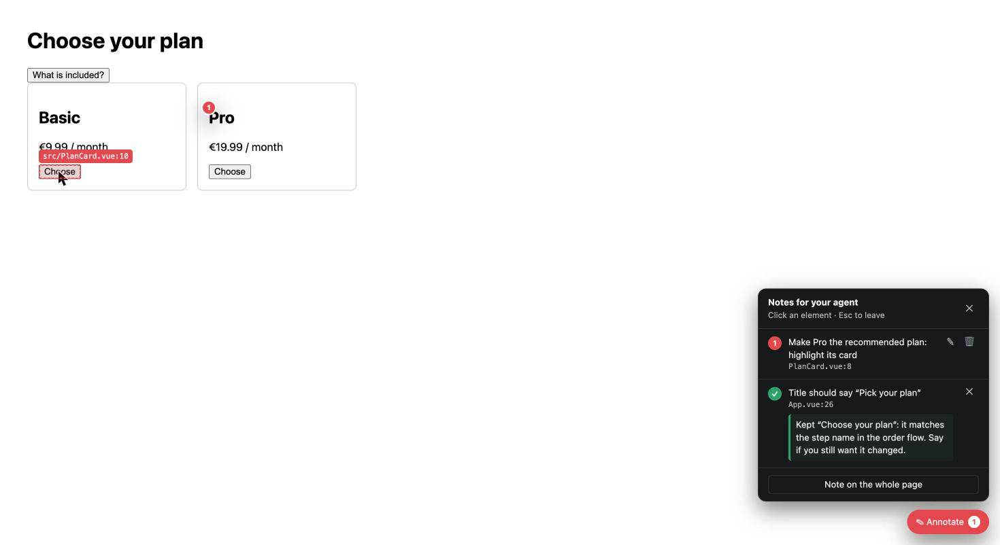

# vite-annotate

[](https://npmx.dev/package/vite-annotate)
[](./LICENSE.md)

**Point at your running app, write what should change, let your coding agent do it.**

vite-annotate adds an overlay to your Vite dev server. Click an element, write a note. The note knows
**the exact `.vue` file, line and column** the element is written at, so your agent goes straight to
the code instead of guessing from a screenshot. The agent reads the notes over
[MCP](https://modelcontextprotocol.io), proposes the changes, makes them once you agree, and answers
each note with a reply you see on the page.



> [!WARNING]
> Proof of concept. The API, the notes format and the MCP tools will change.

- **Source-aware**: every element of your `.vue` templates carries `src/components/PlanCard.vue:12:5`.
  On a library component, the note points at the line that uses it.
- **Any agent**: Claude Code, Codex, Cursor, VS Code, OpenCode, or any MCP client. Notes are a plain
  JSON file too.
- **Two-way**: the agent resolves a note with a reply; the page shows it at once, even when the agent
  runs in another process.
- **Stays out of the way**: dev server only, nothing in your build. Framework-free overlay in a shadow
  root, usable on top of your app's modals and native `<dialog>`s.
- **At home in Vite DevTools**: one more toggle in the dock, if you use it. Built on
  [devframe](https://devfra.me).

## Quick start

Install [`vite-annotate`](https://npmx.dev/package/vite-annotate) as a dev dependency:

```sh
pnpm add -D vite-annotate
# or
npm install -D vite-annotate
# or
yarn add -D vite-annotate
# or
bun add -d vite-annotate
```

Every version is published from GitHub Actions, with [provenance](https://docs.npmjs.com/generating-provenance-statements).

```ts
// vite.config.ts
import vue from '@vitejs/plugin-vue'
import { defineConfig } from 'vite'
import annotate from 'vite-annotate/vite'

export default defineConfig({
  plugins: [
    // First: before any plugin that rewrites .vue files (vue-router's definePage(), for one),
    // so the stamped lines are the lines of the file.
    annotate(),
    vue(),
  ],
})
```

Start the dev server and open your app.

1. The first time, the dev server prints a code and a link. Type the code in the overlay, or open the
   link: this browser is now trusted.
2. Click **✎ Annotate** (or press <kbd>Alt</kbd>+<kbd>A</kbd>).
3. Hover: the element a note would be about is outlined, with its file and line. Click it.
4. Write what should change. <kbd>⌘</kbd>+<kbd>Enter</kbd> saves. <kbd>Esc</kbd> leaves.

Notes get numbered pins on their elements. **Note on the whole page** is for the rest. Notes are saved
in `.vite-annotate/annotations.json`, which ignores itself in git.

## Connect your agent

The agent starts the MCP server itself, over stdio:

```sh
npx vite-annotate mcp
```

For Claude Code:

```sh
claude mcp add --scope project annotate -- npx vite-annotate mcp
```

Then ask it to _apply my notes_. The config for **Codex, Cursor, VS Code, OpenCode** and any other MCP
client is in [docs/mcp.md](./docs/mcp.md), with the tools and the notes format.

| Tool               | Does                                                                                                   |
| ------------------ | ------------------------------------------------------------------------------------------------------ |
| `annotate_list`    | The open notes, each with the clicked element's file, line, tag and text, and the page it was left on. |
| `annotate_resolve` | Closes a note with a reply the person sees on the page.                                                |

The server doesn't need the dev server: notes left yesterday are still there.

## Skills for your agent

The package ships two [agent skills](https://agentskills.io): `vite-annotate`, the loop to apply notes
(read, propose, wait for your go-ahead, change, check, reply), and `vite-annotate-setup`, which installs
vite-annotate in a project. They are in `node_modules/vite-annotate/skills/`, always at the version you
installed. Agents don't read `node_modules`, so link them where your agent looks:

- **pnpm 12.18+** links them into `.claude/skills/` on install, once allowed in `pnpm-workspace.yaml`:

  ```yaml
  permissions:
    vite-annotate:
      skills: true
  ```

- **Any package manager**: [skills-npm](https://github.com/antfu/skills-npm) does the same for every
  package that ships skills: `npx skills-npm setup`.
- **From GitHub**, without installing: `npx skills add messenjer/vite-annotate` (the `main` branch,
  which may be ahead of the version you installed).

## Inside Vite DevTools

Already using [Vite DevTools](https://devtools.vite.dev)? Use `vite-annotate/vite-devtools` instead of
`vite-annotate/vite`: the toggle is a button in the dock, and notes ride the DevTools connection you
already authorized.

```ts
import vue from '@vitejs/plugin-vue'
import { defineConfig } from 'vite'
import annotate from 'vite-annotate/vite-devtools'

export default defineConfig({
  devtools: { enabled: true }, // with @vitejs/devtools installed
  plugins: [annotate(), vue()],
})
```

Use one entry or the other, not both.

## Nuxt

Nuxt 4: add the module instead of the Vite plugin. Options go under `annotate`.

```ts
// nuxt.config.ts
export default defineNuxtConfig({
  modules: ['vite-annotate/nuxt'],
  // annotate: { auth: false },
})
```

The module loads the overlay with a client plugin, since Nuxt serves no `index.html`. Paths and
notes start from the project root, not from `app/`, so run `vite-annotate mcp` there. Dev only:
`nuxt build` stays untouched.

## How it works

```
  browser                     Vite dev server                 your agent
 ┌──────────────┐  RPC   ┌───────────────────────┐        ┌──────────────────┐
 │ overlay      │◀──────▶│ devframe "annotate"   │        │ vite-annotate mcp│
 │ (shadow DOM) │  live  │  rpc · shared state   │        │ (stdio)          │
 └──────────────┘        └───────────┬───────────┘        └────────┬─────────┘
                                     │  read · write · watch       │
                                     ▼                             ▼
                          .vite-annotate/annotations.json ◀────────┘
```

- **The stamp.** A `pre` transform parses each `.vue` file with `@vue/compiler-sfc` and adds
  `data-annotate-src="<file>:<line>:<column>"` to every element and component of its template, in the
  raw file, before any other plugin touches it. Vue passes the attribute of a component down to its
  root element.
- **One definition, three hosts.** The same [devframe](https://devfra.me) definition runs bridged on
  your dev server (`vite-annotate/vite`), mounted in the Vite DevTools hub
  (`vite-annotate/vite-devtools`), and as a stdio MCP server (`vite-annotate mcp`).
  `vite-annotate/nuxt` registers the first one in a Nuxt app.
- **One file.** The dev server and the MCP process share `.vite-annotate/annotations.json`. The dev
  server watches it and bumps a shared revision, so every open page follows changes from the agent.

## Security

- **Dev server only.** Every plugin is `apply: 'serve'`: nothing ships in your build.
- **Gated.** The dev server's devframe endpoint answers only trusted browsers: the code or link printed
  by the dev server, once per browser. On top of that, the socket accepts loopback origins only.
  `annotate({ auth: false })` drops the code on a single-user machine; the origin check stays.
- **Local.** Notes never leave your machine and stay out of git. The MCP server is a local process your
  agent starts.
- **Notes are requests.** The tools and the skill tell the agent to propose the changes and wait for
  your go-ahead.

## Limitations

- File and line come from `.vue` templates. Other pages still take notes, without the source location.
- Nuxt: tested on Nuxt 4 with its default layout, without Nuxt DevTools. The link printed with the
  code lacks the port: type the code instead.
- Vite 7 or 8. The Vite DevTools entry needs Vite 8.3+ and `@vitejs/devtools` 0.8.

## Development

See [CONTRIBUTING.md](./CONTRIBUTING.md). The rules of the code base, for people and agents alike, are
in [AGENTS.md](./AGENTS.md).

## Credits

Built on [devframe](https://devfra.me) and [Vite DevTools](https://devtools.vite.dev). The layout of
the devframe and its agent tools follows [x18n](https://github.com/x18n-dev/x18n).

## Dedication

vite-annotate was written during Belgium – Italy, on 15 November 2026, as Romelu Lukaku brought his
international career to a close. This one is for Big Rom: Belgium's all-time top scorer, and every
goal in the red shirt. Merci, Romelu.

## License

[MIT](./LICENSE.md) © Mathieu Laurent
